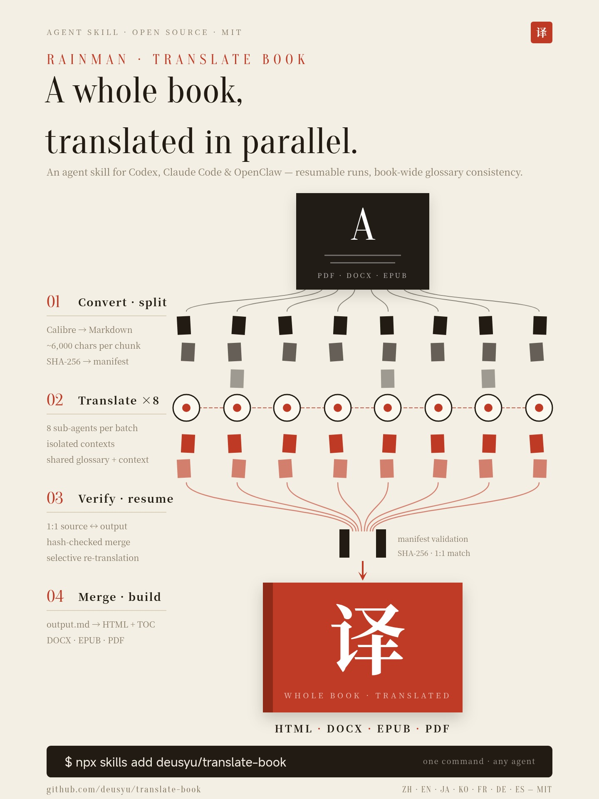

# Rainman Translate Book

[English](README.md) | [中文](README.zh-CN.md) | 日本語

Codex、Claude Code、OpenClaw 向けのエージェントスキルです。並列サブエージェントを使い、書籍まるごと（PDF/DOCX/EPUB）を任意の言語に翻訳します。

<p align="center">
  
</p>

> [claude_translater](https://github.com/wizlijun/claude_translater) に着想を得ています。元のプロジェクトはシェルスクリプトをエントリポイントとし、Claude CLI と複数のステップスクリプトを組み合わせてチャンク単位の翻訳を行います。本プロジェクトはそのワークフローを Codex、Claude Code、OpenClaw 向けのエージェントスキルとして再構成し、サブエージェントによるチャンクの並列翻訳、manifest に基づく整合性チェック、再開可能な実行、複数フォーマット出力を 1 本のパイプラインにまとめています。構成も実装も元のプロジェクトと大きく異なるため、fork ではなく独立したプロジェクトです。

---

## 仕組み

```
Input (PDF/DOCX/EPUB)
  │
  ▼
Calibre ebook-convert → HTMLZ → HTML → Markdown
  (or Markdown input, e.g. from MinerU / Marker, skipping Calibre)
  │
  ▼
Split into chunks (chunk0001.md, chunk0002.md, ...)
  │  manifest.json tracks chunk hashes
  ▼
Parallel subagents (8 concurrent by default)
  │  each subagent: read 1 chunk → translate → write output_chunk*.md
  │  batched to respect API rate limits
  ▼
Validate (manifest hash check, 1:1 source↔output match)
  │
  ▼
Merge → Pandoc → HTML (with TOC) → Calibre → DOCX / EPUB / PDF
```

チャンクごとに、新しいコンテキストウィンドウを持つ独立したサブエージェントが割り当てられます。1 つのセッションで書籍全体を翻訳するときに起きるコンテキストの蓄積や出力の途切れを防ぐためです。

## 特長

- **並列サブエージェント** — バッチごとに 8 つの翻訳エージェントが同時に動き、それぞれのコンテキストは分離されています
- **再開と選択的な再翻訳** — チャンク単位で再開でき、`run_state.json` が用語集の変更に応じた再翻訳を追跡します
- **隣接コンテキスト** — 各チャンクは前後のチャンクの短い読み取り専用の抜粋を参照でき、代名詞や固有名詞の解決に使えます
- **manifest による検証** — SHA-256 ハッシュの追跡により、古い出力や壊れた出力がマージされるのを防ぎます
- **複数フォーマット出力** — HTML（フローティング目次付き）、DOCX、EPUB、PDF
- **オプションの出力設定** — EPUB 表紙の明示指定、一時ディレクトリの親ディレクトリ変更、ユーザー向けのエクスポート別名
- **多言語対応** — zh、en、ja、ko、fr、de、es（拡張可能）
- **PDF/DOCX/EPUB/Markdown 入力** — 変換の重い処理は Calibre が担います。数式や表の多い PDF は、MinerU や Marker で先に Markdown へ抽出できます

## 前提条件

- **エージェント実行環境** — Codex、Claude Code、または OpenClaw がインストール済みで、スキルを実行できること
- **Calibre** — `ebook-convert` コマンドが使えること（[ダウンロード](https://calibre-ebook.com/)）
- **Pandoc** — HTML↔Markdown 変換に使用（[ダウンロード](https://pandoc.org/)）
- **Python 3** と以下のパッケージ:
  - `pypandoc` — 必須（`pip install pypandoc`）
  - `beautifulsoup4` — 任意。目次生成の精度が上がります（`pip install beautifulsoup4`）
- **MinerU または Marker** — 任意。数式や表の多い PDF を事前に Markdown へ抽出する場合のみ（[ステップ 1](#ステップ-1変換) を参照）

## クイックスタート

### 1. スキルをインストールする

#### Codex

```bash
npx skills add deusyu/translate-book -a codex -g
```

手動でインストールする場合:

```bash
mkdir -p ~/.agents/skills
git clone https://github.com/deusyu/translate-book.git ~/.agents/skills/translate-book
```

インストールしたスキルが表示されない場合は、Codex を再起動してください。

#### Claude Code

```bash
npx skills add deusyu/translate-book -a claude-code -g
```

手動でインストールする場合:

```bash
mkdir -p ~/.claude/skills
git clone https://github.com/deusyu/translate-book.git ~/.claude/skills/translate-book
```

#### OpenClaw

```bash
openclaw skills install @deusyu/translate-book
```

### 2. 書籍を翻訳する

#### Codex

Codex CLI または IDE 拡張機能で次のように入力します:

```text
$translate-book Translate /path/to/book.pdf into Chinese.
```

依頼内容がスキルの説明に合致すれば、Codex が自動的にスキルを選ぶこともあります。

#### Claude Code と OpenClaw

エージェントにこう依頼します:

```text
translate /path/to/book.pdf to Chinese
```

Claude Code ではスラッシュコマンドも使えます:

```text
/translate-book translate /path/to/book.pdf to Japanese
```

変換、分割、並列翻訳、検証、マージ、全出力フォーマットの生成まで、スキルがパイプライン全体を自動で処理します。

### 3. 出力を確認する

すべてのファイルは `{book_name}_temp/` にあります:

| ファイル | 説明 |
|------|-------------|
| `output.md` | マージ済みの翻訳 Markdown |
| `book.html` | フローティング目次付きの Web 版 |
| `book.docx` | Word 文書 |
| `book.epub` | 電子書籍 |
| `book.pdf` | 印刷向け PDF |

## リポジトリのテスト資産

- リポジトリに含まれるベースライン入力は `tests/baselines/<book-id>/` にあります。
- パイプライン全体のテストで生成される出力は `tests/.artifacts/` に置き、コミットしません。
- `scripts/convert.py` はカレントディレクトリの下に `{book_name}_temp/` を書き出すため、生成物がリポジトリのルートに散らからないよう、ベースラインテストは `tests/.artifacts/` の中で実行してください。

### パイプライン全体のベースライン例

```bash
mkdir -p tests/.artifacts
cd tests/.artifacts
python3 ../../scripts/convert.py ../baselines/standard-alice/standard-alice.epub --olang zh
# then run translation via the skill
python3 ../../scripts/merge_and_build.py --temp-dir standard-alice_temp --title "test"
```

## フィードバックとコントリビューション

いきなり pull request を送るのではなく、詳しい GitHub issue を作成してください。本プロジェクトは AI 支援のスキルパイプラインとして保守されており、変更は現在のオーケストレーションルール、chunk/manifest の契約、ベースライン資産、リリース手順と照らし合わせて、メンテナーが把握する 1 つのコンテキストの中で評価する必要があります。

pull request は推奨される貢献方法ではなく、issue に切り替えるために close されることがあります。すでにパッチがある場合は、アイデア、主要な diff、失敗するケース、検証結果を issue に書いてください。メンテナーが実装を書き直したり分割したりしてからマージすることがあります。

役に立つ issue には次の内容を含めてください:

- 現在の動作と期待する動作
- 入力フォーマットと環境（PDF/DOCX/EPUB、OS、Python、Calibre、Pandoc のバージョンなど）
- 最小限の再現手順。可能であれば小さなパブリックドメインのサンプル
- 失敗を示すログ、スクリーンショット、生成されたファイル名

## 連絡先

バグ報告や機能要望は、上記のとおり [GitHub issue](https://github.com/deusyu/translate-book/issues) を作成してください。質問やアイデア、その他の話題はこちらからどうぞ:

| チャネル | リンク |
|---------|------|
| X (Twitter) | [@0xdeusyu](https://x.com/0xdeusyu) |
| Telegram | [@DeusThink](https://t.me/DeusThink) |
| Telegram グループ（中国語） | [@talkdeusyu](https://t.me/talkdeusyu) |
| Telegram チャンネル（中国語） | [@lovedesuyu](https://t.me/lovedesuyu) |
| メール | [rainman.deus@gmail.com](mailto:rainman.deus@gmail.com) |

商用スポンサーについては、下の[商用スポンサー](#商用スポンサー)を参照してください。

チャンネルは AI とともに考えたことを記録している場所で、グループはその議論の場です。translate-book に関する質問も歓迎します。

## パイプラインの詳細

### ステップ 1：変換

```bash
python3 scripts/convert.py /path/to/book.pdf --olang zh
```

Calibre が入力を HTMLZ に変換し、それを展開して Markdown に変換したうえで、チャンク（1 つあたり約 6000 文字）に分割します。`manifest.json` には各ソースチャンクの SHA-256 ハッシュが記録され、後の検証に使われます。`source_fingerprint.json` は一時ディレクトリを、それを生成した元ファイルのバイト列に結び付けます。元ファイルを差し替えて再実行すると、古いチャンクを黙って再利用するのではなく中断します。フィンガープリント導入以前に作られた一時ディレクトリは、最初の再実行時に警告付きで引き継がれます。

HTML → Markdown の段階では、Calibre のマークアップも構造的に整理します。EPUB の脚注（本文中の `<a href="#n1"><sup>1</sup></a>` のようなマーカーリンクと、そこへ戻るリンクで始まる注釈段落の組み合わせ）は Pandoc の脚注（本文に `[^1]`、段落の直後に `[^1]: …`）に変換されます。番号は書籍全体で通しになるため、章ごとの番号がマージ後に衝突することはありません。書籍内リンクはテキストだけが残り、`{lang="…"}` のような span 属性、空のページアンカー、見出しの id は削除されます。ダッシュや引用符は `---` やエスケープされた ASCII 引用符にならず、Unicode のまま残ります。戻りリンクのない注釈（EPUB 3 の `<aside>` 脚注など）は通常の段落のままです。

デフォルトの作業ディレクトリは、カレントディレクトリの下の `{book_name}_temp/` です。`--temp-root /path/to/work` を使うと、同じ名前のディレクトリを別の親ディレクトリの下に作れます。

#### 数式や表の多い PDF：代わりに Markdown を変換する（任意）

Calibre は座標のヒューリスティクスで PDF のテキストを再構成します。普通の文章ならそれで十分ですが、学術書や技術書の PDF では構造が崩れます。数式は断片に分かれ、表は 1 行 1 セルに平坦化され、段組みのページは行が入り混じります。そうした PDF は、まずレイアウトを理解するパーサーで抽出し、出力された Markdown を `convert.py` に渡してください。`.md` / `.markdown` の入力は Calibre を完全にスキップします:

```bash
pip install -U "mineru>=4.0,<5"                # or: pip install marker-pdf
mineru-kit parse paper.pdf -o paper.md         # MinerU >= 4 (CPU-only basic tier: ~0.8 GB of models)
# marker_single paper.pdf --output_dir out/    # Marker: writes out/paper/paper.md
python3 scripts/convert.py paper.md --olang zh
```

これらのパーサーは数式を `$...$` / `$$...$$` の LaTeX として、表を表として保持します。`convert.py` は Markdown ファイルの隣から参照されている画像をコピーし、MinerU がインライン化した base64 画像をデコードして `{book_name}_temp/images/` に保存するため、チャンクに画像データが含まれることはありません。ディスプレイ数式のブロック（`$$ ... $$`）がチャンクをまたいで分割されることはありません。YAML フロントマター（`title`、`author`、`lang`）は `config.txt` に反映され、翻訳には送られません。フロントマターがない場合は、先頭の `#` 見出しが `original_title` になります。一時ディレクトリは Markdown ファイル名にちなんで命名されるため、`paper.md` なら `paper_temp/` です。そのディレクトリが `paper.pdf` から作られたものであれば、`convert.py` はソースのフィンガープリント不一致で中断するので、先に削除してください。どちらのパーサーも初回実行時に ML モデルをダウンロードします。`--strip-page-numbers` と `--detect-page-numbers` は Calibre 経由の入力にのみ適用されます。

ビルド時、Pandoc は `$...$` / `$$...$$` を MathML としてレンダリングします。そのため数式は `book.html` と `book.pdf` で組版され、`book.epub` でも MathML に対応したリーダーなら組版されます。Calibre の DOCX 出力は MathML を組版できないため、DOCX では数式が平坦なテキストとして表示され、その後に TeX のソースが続きます。

### ステップ 1.5：用語集（チャンク間の用語の一貫性）

各チャンクは新しいコンテキストのサブエージェントが翻訳するため、100 チャンクの書籍では同じ固有名詞の訳が複数に揺れることがあります。これを防ぐため、スキルは翻訳の前に用語集を作ります:

1. 5 つのチャンク（最初、最後、中間から等間隔に 3 つ）をサンプリングします。
2. 固有名詞と繰り返し登場する専門用語を抽出し、正規の訳語を決めます。
3. `<temp_dir>/glossary.json` に書き出します（手で編集できるスキーマは以下のとおり）。
4. `python3 scripts/glossary.py count-frequencies <temp_dir>` を実行して用語ごとの出現頻度を埋めます（ASCII の用語は単語境界の正規表現を使うため `cat` が `category` にマッチすることはありません。CJK の用語は部分文字列で照合し、CJK 1 文字だけの用語は拒否されます。別名の出現は、それが属する用語にカウントされます）。
5. オーケストレーターはチャンクごとに `python3 scripts/glossary.py print-terms-for-chunk <temp_dir> chunkNNNN.md` を呼び出し、得られた 3 列（`原文 | 别名 | 译文`）の Markdown 表を、そのチャンクのプロンプトに守るべき制約として注入します。選ばれる用語 =（そのチャンクに原語またはいずれかの別名が登場する用語）∪（書籍全体で出現頻度上位 N 件）。

```json
{
  "version": 2,
  "terms": [
    {"id": "Manhattan", "source": "Manhattan", "target": "曼哈顿",
     "category": "place", "aliases": [], "gender": "unknown",
     "confidence": "medium", "frequency": 12,
     "evidence_refs": [], "notes": ""}
  ],
  "high_frequency_top_n": 20,
  "applied_meta_hashes": {}
}
```

既存の v1 の `glossary.json` は、最初の読み込み時に自動で v2 にアップグレードされます。v2 では、同じ表記（原語または別名）が 2 つの異なる用語に現れることを禁止しています。v1 のファイルに多義的な重複原語がある場合、アップグレードは曖昧さ解消を求めるメッセージとともに中断します。ファイルを手で修正してから再読み込みしてください。

訳語を直したいときは、実行の合間に `glossary.json` を編集します。既存の `glossary.json` が上書きされることはないので、一から作り直したい場合は削除してください。`scripts/run_state.py` は各チャンクがどの用語を使ったかを記録するため、状態が記録された後であれば、用語集の変更（`target`、`category`、`aliases` の編集を含む）で再翻訳されるのは影響を受けるチャンクだけです。

### ステップ 2：翻訳（並列サブエージェント）

スキルはサブエージェントをバッチ単位で起動します（デフォルトは同時 8 つ）。各サブエージェントは:

1. ソースチャンクを 1 つ読み込みます（例: `chunk0042.md`）
2. 対象言語に翻訳します
3. チャンクごとの用語表と、前後のチャンクの短い読み取り専用の抜粋を使います
4. 結果を `output_chunk0042.md` に書き出します
5. 用語集へのフィードバック用に、観察結果を `output_chunk0042.meta.json` に書き出します

サブエージェントを起動する前に、`scripts/run_state.py plan <temp_dir>` が、翻訳が必要なチャンク、状態の記録だけが必要な既存出力、変更のないチャンクを判定します。`--retranslate-untracked` は、既存の出力を現在の用語集で強制的に処理し直したい古い一時ディレクトリを引き継ぐときにだけ使ってください。実行が中断された場合、再実行すると有効な出力ファイルがあり状態も最新のチャンクはスキップされます。失敗したチャンクは自動的に 1 回だけ再試行されます。

### ステップ 3：マージとビルド

```bash
python3 scripts/merge_and_build.py --temp-dir book_temp --title "《translated title》"
```

オプションの出力フラグ:

```bash
python3 scripts/merge_and_build.py --temp-dir book_temp --title "《translated title》" --cover cover.jpg --export-name "translated-title"
```

`--cover` は、指定した画像を EPUB を生成する Calibre のステップに渡します。`--export-name` は、パイプラインの正規の成果物 `book.*` を残したまま、`translated-title.epub` のような別名のコピーを作ります。`book_doc` という名前（大文字小文字を区別しない）は予約されており、HTML の別名が `book_doc.html` を上書きしてしまうため、ビルド前に拒否されます。

マージの前に、スクリプトは次の点を検証します:
- すべてのソースチャンクに対応する出力ファイルがあること（1:1 の対応）
- ソースチャンクのハッシュが manifest と一致すること（古い出力がないこと）
- 空、空白のみ、または読み取れない出力ファイルがないこと。空白だけのチャンクがあると、その内容を黙って落とすのではなくマージを中断します
- すべての出力チャンクが、ソースチャンクの脚注マーカー（`[^N]` と `[^N]:`）を保持していること。参照や注釈が宙に浮くことはありません

その後: マージ → Pandoc で HTML → 目次を挿入 → Calibre で DOCX、EPUB、PDF を生成。

ビルド後も中間ファイルは一時ディレクトリに残るため、問題のある数か所を直すのに書籍全体を再翻訳する必要はありません。該当する `output_chunkNNNN.md` を編集して `python3 scripts/run_state.py record <temp_dir> chunkNNNN` を実行するか、そのファイルを削除してスキルを再実行し、再翻訳させます。`record` はそのチャンクを現在の用語集とソースに一致するものとして記録するので、先に `python3 scripts/run_state.py plan <temp_dir>` を実行してください。用語集やソースの変更によってそのチャンクが再翻訳の対象になっている場合は、その変更も編集に反映するか、代わりに再翻訳します。ソースチャンク自体を編集した場合は、`manifest.json` に変更が記録されるよう先に `convert.py` を再実行してください。そうしないとマージは "Source changed since splitting" で停止します。この再実行では `--strip-page-numbers` などのページ番号フラグを付けないでください。チャンクが存在するとそれらのフラグは中断し、エラーの指示どおりにキャッシュファイルを削除するとチャンクも失われます。再実行では、翻訳後に用語が変わった他のチャンクが再翻訳の対象に並ぶこともあります。その場合、スキルは再翻訳する前に確認します。最後に `merge_and_build.py` を再実行します。`output.md` より新しいチャンクがあれば再マージし、出力を作り直します。`output.md` 自体は編集しないでください。以降の再マージでチャンクから作り直されます。`--cleanup` は `chunk*.md`、`output_chunk*.md`、`input.*` を完全に削除するため、こうした修正はできなくなります。書籍を仕上げ終えたときだけ使ってください。

**注意:** `{book_name}_temp/` は 1 回の翻訳実行のための作業ディレクトリです。タイトル、著者、出力言語、テンプレート、画像アセットを変更する場合は、新しい一時ディレクトリを使うか、再実行の前に既存の最終成果物（`output.md`、`book*.html`、`book.docx`、`book.epub`、`book.pdf`）を削除してください。

## プロジェクト構成

| ファイル | 役割 |
|------|---------|
| `SKILL.md` | エージェントスキルの定義 — パイプライン全体をオーケストレーションします |
| `scripts/convert.py` | PDF/DOCX/EPUB → Calibre HTMLZ 経由で Markdown チャンクへ。Markdown 入力は Calibre をスキップ |
| `scripts/manifest.py` | チャンクの manifest: SHA-256 の追跡とマージ時の検証 |
| `scripts/glossary.py` | 用語集の管理: 用語を統一するためのチャンクごとの用語表 |
| `scripts/chunk_context.py` | サブエージェントのプロンプト用の、前後チャンクの読み取り専用抜粋 |
| `scripts/meta.py` | チャンクごとのサブエージェント観察ファイル（`output_chunkNNNN.meta.json`）のスキーマ |
| `scripts/merge_meta.py` | バッチ境界でのマージ: サブエージェントの観察結果 → 正規の用語集 |
| `scripts/run_state.py` | 選択的再翻訳のプランナーと `run_state.json` の記録 |
| `scripts/merge_and_build.py` | チャンクのマージ → HTML → DOCX/EPUB/PDF |
| `scripts/calibre_html_publish.py` | フォーマット変換用の Calibre ラッパー |
| `scripts/template.html` | フローティング目次付きの Web 用 HTML テンプレート |
| `scripts/template_ebook.html` | 電子書籍用 HTML テンプレート |
| `tests/baselines/` | パイプライン全体のテスト用にリポジトリに含めたベースライン書籍 |
| `tests/.artifacts/` | パイプライン全体のテスト出力（git 管理外） |

## トラブルシューティング

| 問題 | 対処 |
|---------|----------|
| `Calibre ebook-convert not found` | Calibre をインストールし、`ebook-convert` が PATH に含まれていることを確認してください |
| `Manifest validation failed` | 分割後にソースチャンクが変更されています — `convert.py` を再実行してください |
| `was created from different source bytes` | 一時ディレクトリが別のソースファイルのものです — 一時ディレクトリを削除するか、新しい `--temp-root` を使ってください |
| 変換後に PDF の数式や表が崩れる | MinerU または Marker で PDF を抽出し、古い一時ディレクトリを削除してから、`.md` に対して `convert.py` を実行してください（[ステップ 1](#ステップ-1変換) を参照） |
| `Blank output` / `Empty output` | サブエージェントが空白のみ、または空のチャンクを書き出しました — スキルを再実行して再翻訳してください |
| `Missing source chunk` | ソースファイルが削除されています — `convert.py` を再実行して再生成してください |
| 翻訳が途中で終わっている | スキルを再実行してください — 止まったところから再開します |
| ビルド後に数か所だけ直したい | `output.md` ではなく該当する `output_chunkNNNN.md` を直し、`merge_and_build.py` を再実行してください（[ステップ 3](#ステップ-3マージとビルド) を参照） |
| タイトル、テンプレート、アセットを変えたのに出力が更新されない | 一時ディレクトリから既存の `output.md`、`book*.html`、`book.docx`、`book.epub`、`book.pdf` を削除し、`merge_and_build.py` を再実行してください |
| PDF 出力からページ番号のフッターを取り除きたい | PDF 入力では、単調に増えるページ番号の並び（例: `1, 2, 3, ...`）を自動検出して削除し、年（`1984`）、章番号、引用番号のような外れ値は残します。EPUB と DOCX ではページ番号がテキストではない（EPUB はアンカー、DOCX はフッター）ため、単独の数字はすべて残します。ページ番号をテキストとして印字している EPUB には `--detect-page-numbers` を指定してください。検出がうまくいかない場合は、`convert.py` に `--strip-page-numbers` を指定すると、数字だけの行をすべて積極的に削除します。どちらのフラグも、キャッシュ済みの `input.md` や `chunk*.md` がすでにあると中断します — フラグを有効にするには先にそれらを削除してください。 |
| `output.md exists but manifest invalid` | 古い出力です — スクリプトが自動で削除して再マージします |
| `Glossary upgrade rejected: duplicate source` | v2 では、2 つの用語が同じ原語や別名の表記を共有できません。`glossary.json` を編集して曖昧さを解消し（例: 一方の原語を `Apple` から `Apple (Inc.)` に変える）、再読み込みしてください。 |
| PDF の生成に失敗する | Calibre が PDF 出力に対応した状態でインストールされていることを確認してください |

## ロードマップ

[issue #7](https://github.com/deusyu/translate-book/issues/7) で追跡しています — チャンク間での名前や用語の不一致、代名詞や性別の誤りです。現在のパイプラインは、高頻度の固有名詞、別名や綴りの揺れ、隣接チャンクの代名詞コンテキスト、用語集変更後の選択的再翻訳に対応しています。書籍全体を使った実地検証は、今後の品質チェックとして残っています。計画は、それぞれ独立してリリースできる 4 つのフェーズです。

### 設計原則

- **帳簿付けはスクリプト、意味的なマージは LLM。** 状態、スキーマ、重複排除、ハッシュ、IO は決定的な Python で処理します。命名、性別の判定、別名の判断、衝突の解決は LLM が行います。
- **共有状態の書き手は 1 つだけ。** `glossary.json` と `run_state.json` を書くのはメインエージェントだけで、サブエージェントはチャンクごとの meta ファイルを書きます。ロックは不要です。
- **保守的なマージ。** 新しい固有名詞には根拠が必要です。別名の統合には文字列の類似度だけでなく LLM の判断が必要です。性別は `unknown` から始まり、明確な根拠があるときだけ確定方向へ動きます。衝突があっても正規の値が黙って上書きされることはありません。
- **3 層の状態を 3 つの別ファイルに。** `glossary.json`（正規データ、サブエージェントが読む）、`output_chunkNNNN.meta.json`（チャンクごとの生の観察結果）、`run_state.json`（オーケストレーション）。

### フェーズ 1 — サブエージェントのフィードバックと用語集のマージ（リリース済み）

読み取りと書き込みのループを閉じます。用語集 v2 では `id`、`aliases`、`gender`、`confidence`、`evidence_refs`、`notes` が追加されました（v1 のファイルは最初の読み込み時に自動アップグレードされます。用語表は 3 列になり、別名も選択の対象になります）。サブエージェントは翻訳したチャンクごとに `output_chunkNNNN.meta.json` を出力します。`scripts/merge_meta.py`（`prepare-merge` / `apply-merge` / `status`）が、保守的なルールでバッチごとにマージします。表記の一意性を強制し、不正な meta は隔離（警告、スキップ、カウント）し、`evidence_chunks` と `used_term_sources` の両方で確信度を引き上げ、上限 5 件の FIFO で保持します。SKILL.md の Step 4 / Step 4.5 / Step 5 を参照してください。

### フェーズ 2 — 代名詞のための隣接コンテキスト（リリース済み）

`scripts/chunk_context.py` は、各サブエージェントのプロンプトに `prev_excerpt`（前のチャンクの末尾約 300 文字）と `next_excerpt`（次のチャンクの先頭約 300 文字）を読み取り専用のコンテキストとして注入します。新しい状態ファイルは増えません。

### フェーズ 3 — 選択的再翻訳（リリース済み）

フェーズ 1 のバッチフィードバックは*前向き*にしか改善しません。選択的再実行は `scripts/run_state.py` と `run_state.json` で*後ろ向き*のループを閉じます。チャンクごとに `glossary_version_used`、`entity_ids_used`、`output_hash`、ソースのハッシュ、選択された固有名詞のハッシュを追跡し、5 つの計画ルールで、出力の欠落や空、manifest 上のソースの変化、未記録の出力、記録後のソースの変化、用語の選択やハッシュの変化を扱います。

### フェーズ 4 — ブートストラップのウォームアップ（実験的、フェーズ 1 のデータ次第）

フェーズ 1 では用語集がバッチごとに育つため、最初のバッチは最も小さい用語集しか参照できず、揺れのリスクが最も高くなります。考えられる方法は、逐次ブートストラップ、並列数の可変化、あるいは何もしないことです。判断は、実際の書籍でこのシステムを動かした人に委ねます。

> フェーズ 4 は、実際の書籍での根拠が得られるまで保留です。本番の実行で不足が見つかれば、リリース済みのスキーマも互換性に配慮したマイグレーションで変わる可能性があります。

### 並行トラック — パイプライン / UX のバックログ（一部リリース済み、issue #7 とは別）

最近の PR での議論から、有用なワークフロー改善もいくつか見えてきました。ただしこれらは単発のパッチより広く、リポジトリの契約（成果物の名前、一時ディレクトリの挙動、クリーンアップの意味、EPUB 互換性の範囲）に関わります。現状:

- **EPUB 表紙の明示指定（リリース済み）。** `merge_and_build.py --cover <image>` は、指定した画像を HTML -> EPUB の Calibre ステップに渡します。`--cover-from <epub>` や EPUB 表紙の自動抽出は、さまざまなパッケージ構成にわたる EPUB 解析の互換性を本プロジェクトが引き受けられるようになるまで、対象外です。（context: closed #3）
- **一時作業ディレクトリの場所の設定（リリース済み）。** `convert.py --temp-root <dir>` を明示しない限り、カレントディレクトリに `{book_name}_temp/` を作るデフォルトの挙動は変わりません。（context: closed #4）
- **Calibre/Pandoc の生成物の、より安全なクリーンアップ（一部リリース済み）。** ページ番号と Calibre マーカーの除去は回帰テストで守られており、年、章番号、単調でない単独の数字は残ります。テストを伴いながら、クリーンアップを段階的に改善していきます。（context: closed #5）
- **ユーザー向けエクスポート名のオプション（リリース済み）。** `merge_and_build.py --export-name <stem>` は、パイプラインの正規の成果物 `book.html`、`book_doc.html`、`book.docx`、`book.epub`、`book.pdf` を残したまま、別名のコピーを作ります。（context: closed #6）

## Star History

このプロジェクトが役に立ったら、ぜひ Star ⭐ をお願いします！

[](https://star-history.com/#deusyu/translate-book&Date)

## スポンサー

このプロジェクトで時間を節約できたなら、保守と改善を続けるためにスポンサーをご検討ください。

[](https://github.com/sponsors/deusyu)

### 商用スポンサー

企業による translate-book のスポンサーを歓迎します。条件はご相談に応じます。[rainman.deus@gmail.com](mailto:rainman.deus@gmail.com) までメールでご連絡ください。

お受けできないもの:

- README やドキュメントに、サードパーティのモデルプラットフォームや API 中継サービスのセットアップ手順、base URL、環境変数を掲載すること。translate-book 自体はモデル API を一切呼び出しません。翻訳はユーザー自身のエージェント実行環境（Codex、Claude Code、OpenClaw）の中で行われます。

## ライセンス

[MIT](LICENSE)
